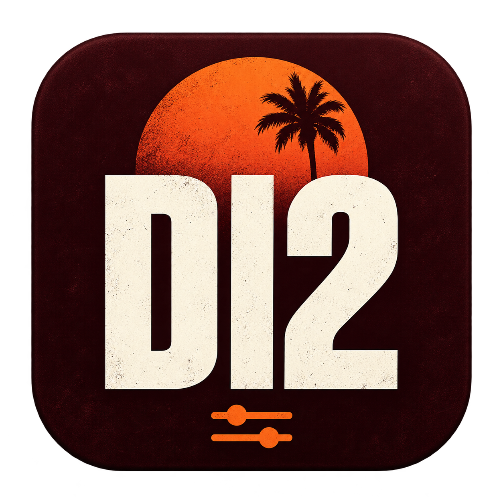

# Dead Island 2 Trainer für macOS



Externer Einzelspieler-Trainer **0.6.4** für **Dead Island 2 0.6.4** auf
Apple Silicon. Unterstützt die Mac-App-Store- und Steam-Version mit einem
kompakten Ingame-Overlay und 26 Bedienelementen.

Die Original-Spiele-Apps bleiben unverändert. Das Overlay läuft im gestarteten
Spielprozess; Geld, XP, Reparaturen und Inventarergänzungen können vom Spiel
normal gespeichert werden. Der Trainer ist kein Save-Editor.

## Launcher

Die Hauptansicht zeigt **Dead Island 2**, die segmentierte Auswahl **Mac App Store /
Steam**, die gefundene Installation mit Spielsymbol und einen großen orangefarbenen
Startknopf sowie einen zweiten roten Knopf **Spiel Uncut mit Trainer starten**.
Der orange Knopf lädt ausschließlich den Trainer. Der rote lädt zusätzlich den
vorhandenen externen Uncut-Helfer und ist nur bei MAS mit verfügbarem Helfer aktiv.
Über **Ändern …** wird die zur ausgewählten Edition gehörende App
zugeordnet. Das **Zahnrad** oder **⌘ + ,** öffnet die vorhandenen Overlay-Optionen
und Positionsvorgaben in einem eigenen Fenster.
Der Steam-Client bleibt über **Steam öffnen** in der Steam-Spielkarte erreichbar.

## Voraussetzungen

- Apple Silicon, macOS 14 oder neuer.
- Eine eigene Originalinstallation eines unten aufgeführten Spiel-Builds.
- Für Steam: ein laufender und angemeldeter Steam-Client.
- Zum Bauen: Xcode/Command Line Tools mit `clang`, `sips`, `iconutil`, `codesign`
  sowie Python 3. Es werden keine zusätzlichen Pakete heruntergeladen.

| Edition | Spielversion | Bundle-ID | Freigegebene Mach-O-UUID |
| --- | --- | --- | --- |
| Mac App Store | 0.6.4, arm64 | `com.plaion.DeadIsland2Usk` | `33AE24EE-5FDC-379A-BD9E-8B1BDE36B6EC` |
| Steam | 0.6.4, arm64 | `com.plaion.DeadIsland2` | `9EB36C68-45E5-3C11-B465-FFD49164B1DA` |

Eine übereinstimmende Versionsnummer allein genügt nicht. Andere UUIDs und
Architekturen werden abgewiesen. Das Projekt enthält keine Spiele, Spielstände,
Originalgrafiken oder fremden Trainer-Binaries.

## Bauen

```sh
git clone https://github.com/darkuser89/Dead-Island-2-MAS-Steam-Trainer.git
cd Dead-Island-2-MAS-Steam-Trainer
export DI2_TRAINER_BUILD_DIR="$HOME/Library/Developer/DeadIsland2Trainer"
./script/build_and_run.sh --build-only
```

Die fertige App liegt unter
`$DI2_TRAINER_BUILD_DIR/Dead Island 2 Trainer.app`. Ohne Umgebungsvariable ist
`~/Library/Developer/DeadIsland2Trainer` das Buildziel. Den gleichen Buildordner
wiederverwenden; Builds innerhalb des Quellordners werden abgewiesen.

Der Build kompiliert Launcher und Overlay, erstellt das App-Icon, signiert die
App lokal ad hoc, prüft die Signatur und führt die synthetischen Tests aus.
Es werden weder private Signierschlüssel noch Administratorrechte benötigt.
Die lokale Ad-hoc-Signatur ist keine Developer-ID-Signatur oder Notarisierung.

| Befehl | Verhalten |
| --- | --- |
| `--build-only` | App bauen und prüfen; kein Launcher- oder Spielstart |
| `--update-only` | Externe App atomar ersetzen, auch während einer laufenden Sitzung; keine Prozesse starten oder beenden |
| `run` oder `--verify` | Bauen, prüfen und den Launcher öffnen; `--verify` prüft zusätzlich dessen Prozess |
| `--test-host` | Bauen und einen synthetischen Metal-Testhost öffnen |
| `--validate-game` | Zusätzlich die Originalsignatur der ausgewählten MAS-Installation lesend prüfen; kein Spielstart |

Vor einem normalen Ersatzbuild laufende Trainer-, Spiel- und Testinstanzen
regulär schließen. `--update-only` verändert bereits geladene Module nicht.
Eine neue Overlay-Version wird erst beim nächsten regulären Spielstart über
den Trainer geladen. Temporäre Austauschbestände werden nach dem Build entfernt;
die neueste App sowie `OverlayPreview.png` und `LauncherPreview.png` bleiben im separaten Buildordner.

## Spiel auswählen und starten

1. Launcher öffnen und **Mac App Store** oder **Steam** auswählen.
2. Den Installationspfad prüfen; bei Bedarf **Spiele-App wählen …** verwenden.
3. Für Steam den Client öffnen und anmelden. **Steam öffnen** startet nur den Client.
4. **Spiel mit Trainer starten** wählen und den Einzelspieler laden.

MAS wird standardmäßig unter `/Applications/DeadIsland2.app` gesucht. Für Steam
werden die Standardbibliothek und die in `steamapps/libraryfolders.vdf`
eingetragenen Bibliotheken berücksichtigt, einschließlich externer Laufwerke.
Ein manuell gewählter Pfad hat Vorrang. Beide Pfade und die zuletzt gewählte
Edition werden nur in den lokalen Launcher-Einstellungen gespeichert.

Der Launcher prüft Originalsignatur, Edition und Hersteller-Teamkennung
`XSBJ2Q9R2T`. Die Steam-App-ID `934700` und die Overlay-Umgebung werden nur dem
neuen Spielprozess übergeben. Steam-Startoptionen und Spieldateien bleiben
unverändert.

Ein bereits installierter externer Helfer unter
`/Applications/Dead Island 2 Uncut.app` kann optional **nur bei MAS** mitgeladen
werden, indem der rote Startknopf gewählt wird. Er ist nicht enthalten und wird
nicht verändert; für den normalen Trainer-Start wird er nicht benötigt.
Der Trainer allein ändert keine USK-Einstellung und verspricht keine iCloud-Funktion.

## Overlay bedienen

- **⌘ + ^**: Overlay anzeigen/verbergen; aktive Schalter bleiben an.
- **⌘⌥ + ^**: Mausbedienung umschalten, ohne das Panel zu verbergen.
- **Esc** oder **×**: Panel schließen und Spielsteuerung zurückgeben.
- **F12**: alle Schalter und ausstehenden Spielaktionen ausschalten, auch beim Laden.
- **− / +** in der Kopfzeile: Größe ändern; **▾**: auf die Kopfzeile einklappen.
- Titelleiste ziehen: Position ändern, sofern im Launcher freigegeben.

Standardgröße: ungefähr **486 × 331 Punkte**. Position, Größe, Sichtbarkeit,
Mausbedienung und optionales Badge lassen sich im Launcher einstellen. Diese
Anzeigeoptionen werden gespeichert; Cheat-Schalter starten bei jedem neuen
Spielprozess ausgeschaltet. Bei macOS-Medientasten gegebenenfalls **fn** verwenden.
**⇧** bedeutet Umschalt, **⌥** bedeutet Option/Alt.

**Grün** bestätigt eine aktive Wirkung; **Orange** bedeutet eingeschaltet,
aber noch auf passende Ausrüstung, Freischaltung oder eine Bestätigung wartend.
Tooltips erklären die jeweilige Grenze. Zahlenwert anklicken, eingeben und mit
**Enter** übernehmen; **Esc** bricht die Eingabe ab. **GO** führt eine Aktion
**einmalig** aus. Bei geöffnetem Panel wird die Maus freigegeben und der
Spiel-Viewport ignoriert Bewegungs-/Schusseingaben; die Welt läuft weiter.

## Funktionen

| Funktion | Taste | Umfang |
| --- | --- | --- |
| Gottmodus | F1 | Eigener nativer God-Mode-Grund |
| Gesundheit auffüllen | F6 | Auffüllen alle 0,25 Sekunden |
| Ausdauer | F2 | Abzug verhindern und auffüllen |
| Waffenhaltbarkeit | F7 | Gehaltene Nahkampfwaffe reparieren und schützen |
| KI ignoriert Spieler | ⌥F5 | Ignorierzustand der lokalen Spieler-ID |
| Spielertempo | ⇧F2 | Zeitfaktor des lokalen Spieler-Actors |
| Bewegungstempo | ⇧F3 | Eigener entfernbarer Laufgeschwindigkeits-Modifikator |
| Spieltempo | ⇧F4 | Zeitfaktor der aktuellen Einzelspieler-Welt |
| Super-Kraftschaden | ⇧F9 | Sehr hoher Nahkampf-Stabilitätsschaden |
| Kraftschaden × | ⇧F8 | Multiplikator des Nahkampf-Kraftattributs |
| One-Hit (Nahkampf) | ⇧F7 | Sehr hoher Nahkampf-Grundschaden |
| Schaden × (Nahkampf) | ⇧F6 | Multiplikator des Nahkampf-Schadensattributs |
| Verteidigung × | ⇧F5 | Eingehenden Schaden reduzieren |
| Geld setzen | ⇧F1 | Zielbetrag einmalig setzen; F4/F5 geben +1.000/+10.000 |
| Verbrauch & Materialien | ⌥F2 | Vorhandene erkannte gewöhnliche Stapel nachfüllen |
| Stapel behalten | ⌥F3 | Zusätzlich Munitionsstapel schützen |
| Crafting ohne Kosten | ⌥F4 | Geld/Material bei freigeschalteten unterstützten Rezepten |
| Munitionsreserve | F3 | Reserve-Flag der gehaltenen Schusswaffe |
| Kein Nachladen | F8 | Separates Magazin-Flag und Auffüllen |
| Präzision | ⇧F10 | Unterstützte Standard-Spread-Handler |
| Kein Rückstoß | ⇧F11 | Unterstützte Standard-Recoil-Handler |
| Curveball sofort bereit | F11 | Lokale Quick-Throw-Abklingzeiten zurücksetzen |
| Wut auffüllen | F9 | Einmalig, bei freigeschaltetem Wutgewinn |
| Wut ohne Zeitlimit | F10 | Nativen Wutabzug verhindern |
| XP bis Maximallevel | ⌥F1 | Einmalige Gabe bis zur regulären Levelschwelle |
| XP-Multiplikator | ⇧F12 | Neue XP-Zuwächse ergänzen, ohne eigene Gaben erneut zu multiplizieren |

Alle 26 Anbindungen sind im Code vorhanden. Das ist keine vollständige
Ingame-Bestätigung aller Schalter, Waffenarten oder Spielsituationen.

### Grenzen und gespeicherte Änderungen

- Gesundheit auffüllen verhindert allein keinen tödlichen Treffer zwischen zwei
  Aktualisierungen. Skriptschaden und Skript-Unverwundbarkeit sind separat zu prüfen.
- Schaden, One-Hit, Kraft und Haltbarkeit gelten für Nahkampfwaffen. Präzision
  und Rückstoß benötigen passende Standard-Handler der Schusswaffe.
- Inventarschalter schützen erkannte gewöhnliche Stapel. Questobjekte, Schlüssel,
  Sammlungen, Rezepte, Geld und Waffen werden nicht nachgefüllt. Auch Verkauf
  oder Ablegen eines geschützten gewöhnlichen Stapels kann Nachfüllen auslösen.
- Crafting unterstützt drei erkannte native Zutatentypen. Es schaltet keine
  Rezepte, Fähigkeiten oder DLCs frei.
- Ausschalten stellt eigene Flags, Faktoren und Modifikatoren wieder her.
  Bereits erhaltenes Geld, XP, Reparaturen oder Gegenstände werden nicht entfernt.
  Das Spiel kann sie regulär speichern; der Trainer erstellt keine Save-Backups.

### Gebietswechsel und Koop

Bei einem Gebietswechsel im Einzelspieler bleiben Schalter und Faktoren gewählt.
Die Wirkungen auf alte Objekte werden gelöst und nach dem Laden neu gebunden.
XP- und Inventar-Basiswerte werden neu erfasst. Einmalige Geld-, XP- oder
Wut-Aktionen werden bei einem Kontextwechsel verworfen, damit sie später nicht
versehentlich ausgeführt werden.

Eine bestätigte Netzwerksitzung sperrt die Cheats, nimmt eigene Wirkungen zurück
und löscht die Auswahl. Das gilt auch bei allein gestarteter Koop-Sitzung.
Zurück im Einzelspieler muss neu aktiviert werden. Overlay, Mausbedienung und
F12 bleiben unabhängig davon verfügbar.

## Tests und Kompatibilitätsprüfung

Der Build prüft synthetisch unter anderem alle 26 Anbindungen, Wiederherstellung,
Waffen- und Besitzerwechsel, tote Weak-Referenzen, numerische Grenzen,
XP-Rückkopplung, Gebietswechsel, Warteschlange und Netzwerksperre. Launcher-Tests prüfen beide Store-Auswahlen, fehlende/laufende Installationen,
Start-/Einstellungsaktionen und kompakte Abmessungen ohne Spielstart. UI-Tests prüfen
Hotkeys, alle 26 Mausaktionen in verschiedenen Größen/Positionen, Zahlenfelder,
Ziehen, Verbergen und Cursor-Wiederherstellung. Editionsprüfungen verwenden
selbst erzeugte kleine App-Fixtures; Originalspiele und Saves werden dafür nicht
benötigt. Der Build startet kein echtes Spiel.

`Tests/verify_game_abi.py` gleicht 95 Symbole, drei Crafting-Tabellen und drei
Abschnittshashes lesend mit vorhandenen unterstützten Original-Builds ab.
Fehlende oder unbekannte Builds werden ausdrücklich als **nicht geprüft**
ausgegeben; synthetische Tests ersetzen diesen Abgleich nicht. Für andere Pfade:

```sh
export DI2_ABI_STEAM_APP="/Pfad/zur/Steam/DeadIsland2.app"
export DI2_ABI_MAS_APP="/Pfad/zur/MAS/DeadIsland2.app"
python3 Tests/verify_game_abi.py .
```

Originalsignaturen lassen sich nach dem Bauen separat prüfen, ohne Spielstart:

```sh
"$DI2_TRAINER_BUILD_DIR/Dead Island 2 Trainer.app/Contents/MacOS/Trainer" --validate-only mas
"$DI2_TRAINER_BUILD_DIR/Dead Island 2 Trainer.app/Contents/MacOS/Trainer" --validate-only steam
```

Für Version 0.6.4 sind Build, Signatur, synthetische Tests, Launcher-Darstellung
und der lesende MAS-ABI-Abgleich geprüft. Die getrennten Startknöpfe wurden mit
Testaktionen ohne Spielstart geprüft. Der Steam-ABI-Abgleich war für Version
0.6.3 erfolgreich; für 0.6.4 wurde er mangels erreichbarer Installation nicht
wiederholt. Steam-Betrieb einschließlich Waffenfunktionen sowie Mausbedienung wurden
vom Nutzer als funktionierend gemeldet. Es liegt weiterhin keine vollständige
Ingame-Testmatrix für alle 26 Funktionen, Gebiete, Waffenarten, langen Sitzungen,
Koop-Übergänge und iCloud-Synchronisierung vor.

## Projektaufbau

| Pfad | Inhalt |
| --- | --- |
| `Sources/Launcher.m`, `Sources/LauncherView.*` | Editionswahl, kompakter Launcher, Einstellungen, Originalprüfung und Spielstart |
| `Sources/Runtime.m` | Prozessbegrenzung, Fenster- und Ereignisanbindung |
| `Sources/Overlay*` | Panel, Maus/Tasten, Anzeigeoptionen und Cursor-Modus |
| `Sources/TrainerFeatures.*` | Gemeinsamer Funktions- und Tastenkatalog |
| `Sources/GameAccess.*` | Versionsgebundene native Anbindungen und begrenzte Datenzugriffe |
| `Sources/GameBridge.*`, `Sources/ExtraFeatures.*` | GameThread-Aufträge, Effekte und Wiederherstellung |
| `Sources/GameEdition.*` | Build-Identität und Installationssuche |
| `Resources/` | App-Metadaten, ABI-Definition und eigenes Icon samt Generierungsprompt |
| `Tests/` | Synthetische Engine-/UI-Tests und lesender ABI-Abgleich |
| `script/` | Gemeinsamer Build-Einstieg |

Alle Unreal-Zugriffe laufen asynchron auf dem GameThread, höchstens ein Auftrag
zugleich. Die Anbindung berücksichtigt ASLR und validiert Objektklassen,
Besitzer und Weak-Referenzen. Es werden Daten bereits schreibbarer Seiten
verändert; Code-Instruktionen und Speicherzugriffsrechte bleiben unangetastet.
Crafting verwendet private Dispatch-Tabellen einzelner Instanzen und verändert
keine Originaltabellen. Details für Änderungen: [CONTRIBUTING.md](CONTRIBUTING.md).

## Lizenz

Copyright © 2026 darkuser89. **GPL-3.0-only**, siehe [LICENSE](LICENSE).
Das eigene Icon wurde mit integrierter Bildgenerierung erstellt; der verwendete
Prompt liegt in [Resources/AppIcon.prompt.txt](Resources/AppIcon.prompt.txt).

Unabhängiges Community-Projekt; keine Verbindung zu PLAION, Deep Silver, Dambuster
Studios, Valve oder Apple. Namen und Marken gehören ihren jeweiligen Inhabern.
